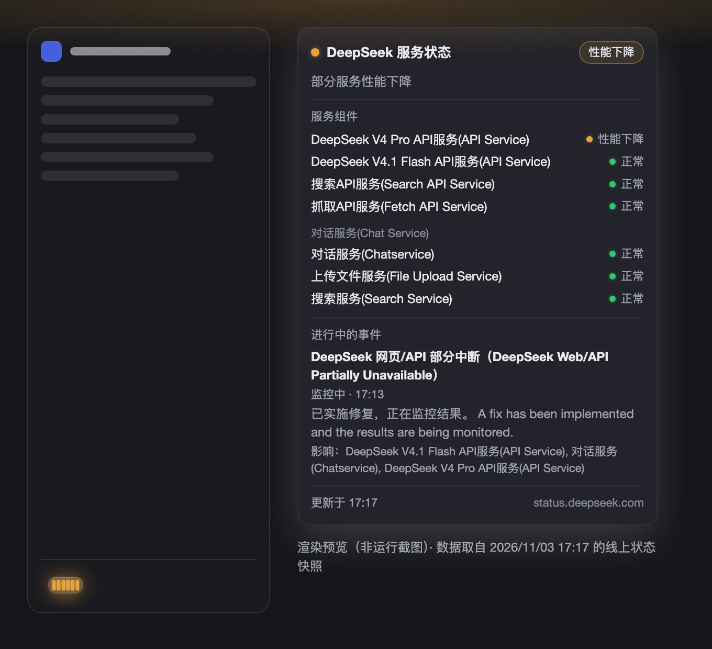
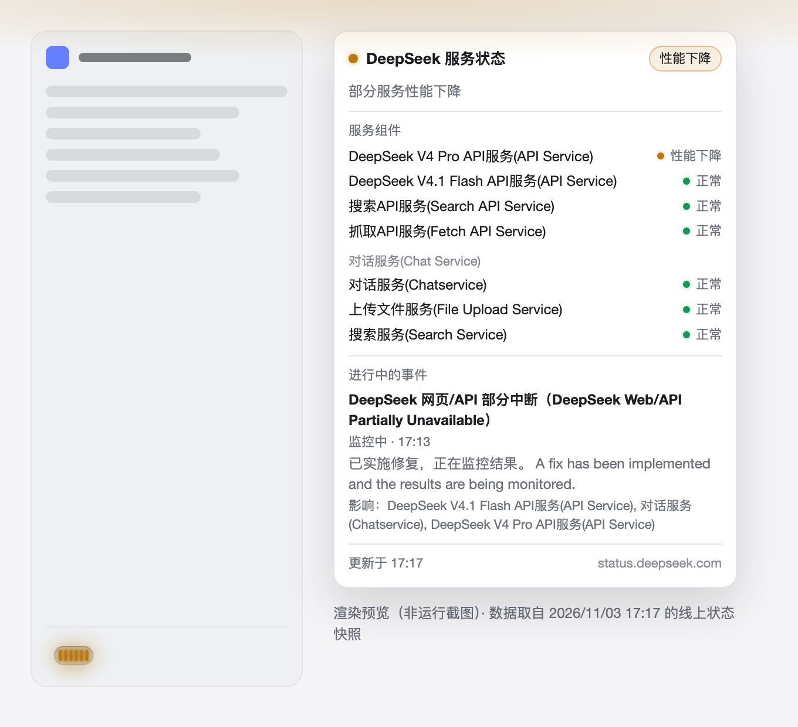
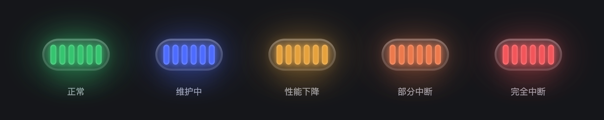

# DeepSeek Status Lamp for DeepSeek Harness

[](https://dsh-plugin.org/plugins/gmchocolate/dsh-deepseek-status)

A DeepSeek Harness plugin bundle that puts a **glowing live status lamp in the left sidebar
footer** and reveals the full DeepSeek platform status when you hover it. Data comes from the
public status page at <https://status.deepseek.com/>.

- **Capability**: UI / experience — an ambient monitoring decoration, no agent tools added.
- **One line**: install it and the Harness sidebar grows a live DeepSeek service-status lamp
  you can read at a glance and inspect by hovering.

## Screenshots







> These images are **renders produced from the plugin's own stylesheet**, filled with a real
> status snapshot taken on 2026-11-03 17:17 (UTC+8) during a degraded incident — the sidebar
> around the lamp is an abstract sketch, the card is the component's real markup. They are not
> window captures of a running Harness, which this environment could not produce.

## Install

### From GitHub (source install)

```bash
dsh plugin --profile web add github:gmchocolate/dsh-deepseek-status
```

Replace `web` with whichever profile you run (`desktop`, `web`, or your own). The command is
`pnpm add` underneath, so `github:<owner>/<repo>` installs the checked-out package directly.
Reload the Harness Web page once afterwards; the client bundle is served per page load.

### From a local checkout

```bash
git clone https://github.com/gmchocolate/dsh-deepseek-status.git
```

Then install the directory with the Harness `plugin_manager` (`install_bundle`, absolute
package directory as `target`).

> **Not on npm yet**, so it does not show up in the in-app 插件中心 (which lists only one-click
> npm plugins). The community marketplace still lists it with the source-install command above.

## What you get

- A **light-tube style lamp** in the sidebar footer: a glass bezel holding ten lit segments,
  with a soft coloured bloom and a faint spill of light below it — about 34px long in the
  wide sidebar and 25px in the collapsed 56px rail, seated at the left edge of the footer row.
- **Colour = state**: green operational · blue maintenance · amber degraded · orange-red
  partial outage · red full outage · grey status unavailable. Amber breathes slowly, red
  pulses faster, and `prefers-reduced-motion` stops both.
- **Hover (or keyboard-focus) the lamp** for a card with the overall state, every service
  component grouped by section with its own state, each active incident or maintenance window
  with its latest update, affected components and update time, plus the upstream source name.
- Text is localized (English and Chinese) through the host locale service, and every colour is
  a host theme token, so it follows the app's light/dark theme.

## How it gets the data

`status.deepseek.com` is a Next.js app-router page: live data arrives inside the served HTML as
a React flight payload, and the origin sends no CORS headers, so a browser cannot read it
directly. The bundle therefore has two halves:

```
status.deepseek.com ──fetch(HTML + flight payload)──▶ Host half
                                                       │ derive one normalized snapshot
                                                       ▼
                        GET /plugins/deepseek-status.json  (same origin)
                                                       │
                                                       ▼
                                                    Client half
```

- **Host half** (`index.js`) fetches the page every 90s, decodes the `initialData` prop
  (component catalog + active changes, whose `affected_components[].status` carries each
  component's current state) and normalizes it. If the payload cannot be parsed it falls back
  to the `history.rss` incident feed. It serves the result as same-origin JSON on an exact
  route, so it cannot shadow other routes or the SPA fallback.
- **Client half** (`client.js`) registers into the `sidebar.footer.action` slot, polls the Host
  route every 60s (and when the tab becomes visible again), and draws the lamp plus the hover
  card.

The browser never calls the status site directly.

## Real output

`npm run test:live` against the live status page:

```
live: overall=degraded
live: counts={"operational":4,"maintenance":0,"degraded":3,"partial_outage":0,"full_outage":0}
  (ungrouped)
    degraded       DeepSeek V4 Pro API服务(API Service)
    degraded       DeepSeek V4.1 Flash API服务(API Service)
    operational    搜索API服务(Search API Service)
    operational    抓取API服务(Fetch API Service)
  对话服务(Chat Service)
    degraded       对话服务(Chatservice)
    operational    上传文件服务(File Upload Service)
    operational    搜索服务(Search Service)
  incident/monitoring: DeepSeek 网页/API 部分中断（DeepSeek Web/API Partially Unavailable）
```

A screenshot of the lamp in the sidebar is still to be added — the lamp renders in the
Harness Web UI as described above.

## Compatibility and requirements

| Item | Value |
| --- | --- |
| DeepSeek Harness | developed and verified on Desktop runtime `0.2.1-rc.5`; the bundle uses only stable extension points (`webServer.register`, `sidebar.footer.action`, `locale`) |
| Platform | macOS verified; Windows / Linux expected to work (plain JS, no native code) but not verified |
| Runtime | no dependencies, no build step; Host half needs a Node with global `fetch` and `AbortSignal.timeout` (Node 18+, DSH ships newer) |
| Permissions | no agent tools, no credentials, no filesystem access; one outbound HTTPS GET to the public status page every 90s |
| External services | `status.deepseek.com` (status page and its `history.rss` fallback); everything else stays local |

## 收录信息（中文）

- **分类**：界面与体验
- **一句话价值**：装好后左侧栏底部多一根发光灯管，随时反映 status.deepseek.com 上的服务状态，悬停即可看到全部组件、进行中事件与更新时间。
- **安装命令**：`dsh plugin --profile web add github:gmchocolate/dsh-deepseek-status`
- **兼容**：DeepSeek Harness Desktop `0.2.1-rc.5` 实测通过；macOS 已验证，Windows/Linux 未验证；无第三方依赖、无构建步骤。
- **许可证**：MIT
- **权限与外部服务**：不注册任何 Agent 工具、不读取凭据与文件；仅每 90 秒对公开状态页发起一次 HTTPS 请求（失败时退回其 RSS 事件流），数据经本机同源路由 `/plugins/deepseek-status.json` 提供给前端。
- **已知限制**：上游页面结构变化时会先退回 RSS 兜底、再显示灰色「状态不可用」；悬浮卡片用 `position: fixed` 定位，若宿主给侧栏祖先加了 `transform` 会有偏移。

## Development

```bash
npm test            # flight parsing, normalization, client render (offline)
npm run test:live   # optional: parse the real status page right now
```

There are no dependencies and no build step: the Host half is a plain Cordis plugin and the
Client half is a plain lazy module (`window.__ModuleLoader__.load`). The tests use only Node
built-ins and a tiny React stand-in, so they run offline.

Runtime tunables live at the top of `index.js` (`REFRESH_MS`, `ROUTE_PATH`, `FETCH_TIMEOUT_MS`)
because a dependency-free bundle cannot declare a `schemastery`-typed `Config`. The lamp
geometry lives in `client.js` (`LAMP_CELLS` selects the segment count; `.dss-cell` width and
height set the tube's proportions).

## Files

| File | Role |
| --- | --- |
| `index.js` | Host half: upstream fetch, parse, normalize, poller, JSON route. |
| `client.js` | Client half: lazy module factory, slot registration, lamp and hover card, EN/ZH dictionaries. |
| `cordis.patch.yml` | Bundle patch that inserts the `deepseek-status` row. |
| `locale/*.json` | Plugin Manager display metadata. |
| `icon.svg` | Plugin icon (original artwork). |
| `test/*.mjs` | Offline tests plus an optional live smoke test. |
| `docs/*.png` | README previews rendered from the plugin stylesheet. |

## Limits

- The JSON route answers any same-origin GET/HEAD without authentication. It carries only
  public status-page data and is bound to the Harness listener (loopback by default).
- The upstream payload shape belongs to the current Flashcat-hosted status page. A redesign
  there degrades to the RSS fallback, then to the grey "unavailable" lamp.
- The hover card is rendered with `position: fixed` from the slot's own measure step; a host
  layout that gives a sidebar ancestor a `transform` would offset it.

## License

[MIT](./LICENSE) © 2026 Nathan
